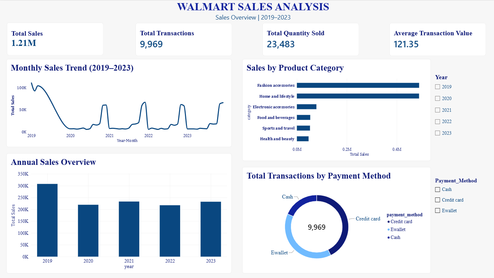
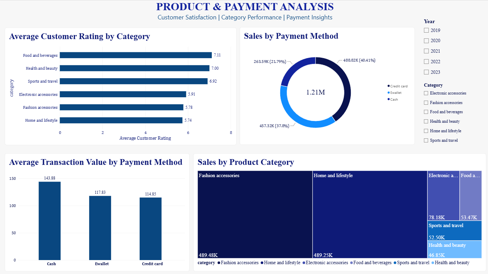
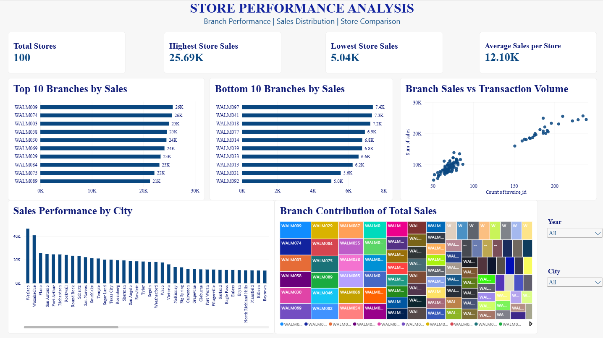

# Walmart Sales Analysis | Google Colab, SQLite & Power BI

## Project Overview

This project focuses on analyzing Walmart sales data to identify business trends, evaluate sales performance, and generate meaningful business insights.

The project follows an end-to-end data analytics workflow using **Google Colab, Python, SQLite, and Power BI**.

- **Google Colab:** Data exploration and cleaning
- **SQLite:** SQL queries and business analysis
- **Power BI:** Interactive dashboards and data visualization

The objective is to transform raw retail sales data into meaningful insights that can support business decision-making.

## Project Objectives

- Analyze overall sales and transaction performance.
- Identify top-performing and low-performing product categories.
- Understand customer ratings across product categories.
- Analyze customer payment preferences and transaction values.
- Evaluate branch-level and city-level sales performance.
- Identify sales trends over different time periods.
- Develop interactive dashboards to communicate business insights.

## Tools & Technologies

| Tool / Technology | Purpose |
|---|---|
| Google Colab | Data exploration and preprocessing |
| Python | Data handling and preprocessing |
| Pandas | Data manipulation and analysis |
| SQLite | SQL queries and business analysis |
| Power BI | Interactive dashboards and visualization |

## Dataset Overview

The project uses Walmart sales data containing **9,969 transactions across 100 branches** after data cleaning.

### Dataset Source

The original dataset was downloaded from Kaggle:

**[Walmart 10K Sales Datasets – Kaggle](https://www.kaggle.com/datasets/najir0123/walmart-10k-sales-datasets)**

The original dataset (`Walmart.csv`) was imported into Google Colab for data exploration, cleaning, and preprocessing. The cleaned dataset (`walmart_cleaned.csv`) was then used for SQL analysis and Power BI dashboard development.

### Important Dataset Columns

- `invoice_id`
- `Branch`
- `City`
- `category`
- `sales`
- `quantity`
- `payment_method`
- `rating`
- `year`
- `year_month`

## Project Workflow

### 1. Data Exploration & Cleaning – Google Colab

- Imported and inspected the original Walmart sales dataset.
- Explored dataset structure, columns, and data types.
- Checked for missing values and duplicate records.
- Performed data cleaning and preprocessing.
- Prepared the cleaned dataset for further analysis.
- Exported the cleaned dataset for use in SQLite and Power BI.

### 2. Data Analysis – SQLite

Used SQLite to write SQL queries and extract meaningful business insights.

The analysis included:

- Total sales and transaction analysis.
- Sales performance by product category.
- Average customer ratings by category.
- Sales distribution by payment method.
- Average transaction value by payment method.
- Yearly and monthly sales trends.
- Branch-level and city-level sales performance.
- Identification of top and bottom-performing branches.

### 3. Dashboard Development – Power BI

Imported the cleaned dataset into Power BI and developed a **three-page interactive dashboard** to visualize key performance indicators and business insights.

## Dashboard Pages

### Page 1 – Sales Overview

Provides a high-level overview of Walmart's overall sales performance.

**Key Performance Indicators (KPIs):**
- Total Sales
- Total Transactions
- Total Quantity Sold
- Average Transaction Value

**Visualizations:**
- Monthly Sales Trend
- Sales by Product Category
- Annual Sales Overview
- Transactions by Payment Method



### Page 2 – Product & Payment Analysis

Focuses on product category performance, customer satisfaction, and payment preferences.

**Visualizations:**
- Average Customer Rating by Category
- Sales by Payment Method
- Average Transaction Value by Payment Method
- Sales by Product Category



### Page 3 – Store Performance Analysis

Evaluates sales performance across Walmart branches and cities.

**Key Performance Indicators (KPIs):**
- Total Stores
- Highest Store Sales
- Lowest Store Sales
- Average Sales per Store

**Visualizations:**
- Top 10 Branches by Sales
- Bottom 10 Branches by Sales
- Sales Performance by City
- Branch Sales vs Transaction Volume
- Branch Contribution to Total Sales



## Key Business Insights

- Total sales reached approximately **1.21 million** across 9,969 transactions.
- A total of **23,483 units** were sold across 100 branches.
- Fashion Accessories and Home & Lifestyle generated the highest sales among product categories.
- Cash payments had the highest average transaction value among the payment methods.
- Food & Beverages recorded the highest average customer rating.
- Branch-level analysis revealed differences in sales performance across locations.

## Interactive Dashboard Features

The Power BI dashboard includes interactive slicers that allow users to explore the data dynamically by:

- Year
- Payment Method
- Product Category
- City

These filters help users compare sales performance across different business dimensions.

## Repository Structure

```text
Walmart/
│
├── Walmart.csv
├── walmart_cleaned.csv
│
├── Walmart_Sales.ipynb
│
├── Walmart_Sales.db
│
├── Walmart_Dashboard.pbix
│
├── Sales_Overview.png
├── Product_Payment_Analysis.png
├── Store_Performance_Analysis.png
│
└── README.md
```

## Conclusion

This project demonstrates an end-to-end data analytics workflow, starting from raw data exploration and cleaning to SQL-based analysis and interactive dashboard development.

By combining Google Colab, SQLite, and Power BI, the project transforms retail sales data into meaningful business insights and visual reports.

Through this project, I strengthened my skills in:

- Data Cleaning and Preprocessing
- Exploratory Data Analysis (EDA)
- SQL Querying and Data Analysis
- Data Visualization
- Business Intelligence
- Dashboard Development

## Dataset Credit

The original dataset is sourced from:

[Najir0123 – Walmart 10K Sales Datasets on Kaggle](https://www.kaggle.com/datasets/najir0123/walmart-10k-sales-datasets)

---

**Project Type:** Data Analytics | Business Intelligence

**Tools:** Google Colab | Python | Pandas | SQLite | SQL | Power BI
